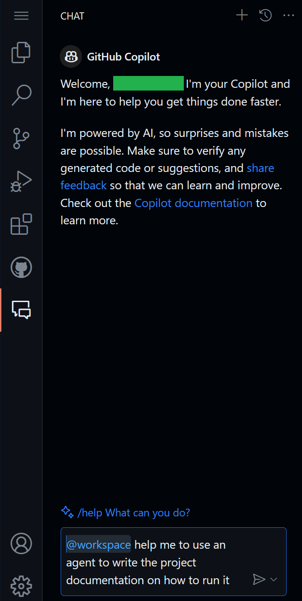

[](https://codespaces.new/MicrosoftDocs/mslearn-advanced-copilot)

# Apply advanced GitHub Copilot techniques
Discover new ways to leverage advanced GitHub Copilot techniques within a Python repository to implement an interactive HTML form and an Application Programming Interface (API) endpoint. 
Gain more practical experience by using this repository that contains a Python Web Application that hosts a Travel Weather API.

[](https://aka.ms/awesome-github-copilot)

## Requirements

1. Enable your [GitHub Copilot service](https://github.com/github-copilot/signup)
1. Open [this repository with Codespaces](https://codespaces.new/MicrosoftDocs/mslearn-copilot-codespaces-python)

## Run in the configured Codespace

The Codespace uses Python 3.10 and the virtual environment at
`/home/vscode/venv`. The project requirements are installed in that
environment when the container is built.

Uvicorn starts automatically when the Codespace attaches; you do not need to
start the server yourself. The configured command is
`/home/vscode/venv/bin/uvicorn --host 0.0.0.0 main:app --reload`. The Codespace
forwards port 8000 and opens its preview automatically. The forwarded port is
private by default. Open the API documentation at `/docs` in the preview, or
try the city-list endpoint:

```text
GET /regions/Spain
```

It returns:

```json
["Seville"]
```

To run the existing tests in the Codespace terminal:

```bash
pytest
```

## 💪🏽 Exercise
The API provides a city-list endpoint at `/regions/{region}` and a monthly
weather endpoint at `/countries/{country}/{city}/{month}`. Use the city-list
endpoint to explore how the API returns cities from `weather.json`.

When extending the API, include tests and run them with pytest.

### 🛠 Step 1: Try the city-list route
Open `/docs` in the Codespace preview and try `GET /regions/{region}` with `Spain`. The response is `["Seville"]`. You can also use inline chat in `main.py` with `ctrl` + `i` (on Windows) or `cmd` + `i` (on Mac) to ask GitHub Copilot to explain how the route gets the city names from the data.

### 🔎 Step 2: Create a test
Use Copilot Chat to create a test for the existing route with Spain as the
region. Select the relevant code and ask Copilot Chat to help you test this
API.

`> /tests help me create a test for GET /regions/{region} using Spain.`




Once Copilot has helped you to create your test, try it. If this is not functioning as expected, feel free to share those details with Copilot in the chat. For example:

`> This test is not quite right; it should verify that Spain returns only Seville.`


It should give you another solution. Keep trying until you achieve the desired result.

### 🐍 Step 3: Review the docs with an agent
Use an agent (workspace) to review and improve the project documentation. In
GitHub Copilot Chat, try the following prompt:

`> @workspace review the run instructions and suggest any missing setup steps.`

Finally, verify the new endpoint is working by trying it out by going to the `/docs` endpoint and confirming that the endpoint shows up.


🚀 Congratulations, through the exercise, you haven't only used copilot to generate code but also done it in an interactive and fun way! You can use GitHub Copilot to not only generate code, but write documentation, test your applications and more.


# Legal Notices

Microsoft and any contributors grant you a license to the Microsoft documentation and other content
in this repository under the [Creative Commons Attribution 4.0 International Public License](https://creativecommons.org/licenses/by/4.0/legalcode),
see the [LICENSE](LICENSE) file, and grant you a license to any code in the repository under the [MIT License](https://opensource.org/licenses/MIT), see the
[LICENSE-CODE](LICENSE-CODE) file.

Microsoft, Windows, Microsoft Azure and/or other Microsoft products and services referenced in the documentation
may be either trademarks or registered trademarks of Microsoft in the United States and/or other countries.
The licenses for this project do not grant you rights to use any Microsoft names, logos, or trademarks.
Microsoft's general trademark guidelines can be found at http://go.microsoft.com/fwlink/?LinkID=254653.

Privacy information can be found at https://privacy.microsoft.com/en-us/

Microsoft and any contributors reserve all other rights, whether under their respective copyrights, patents,
or trademarks, whether by implication, estoppel or otherwise.
